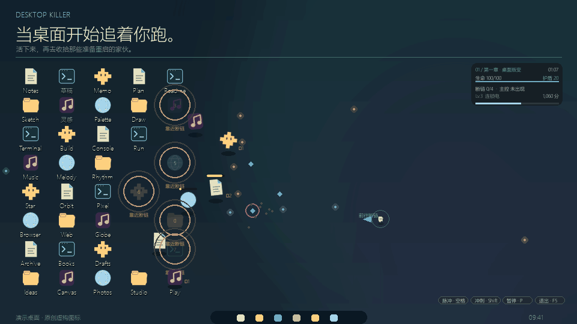
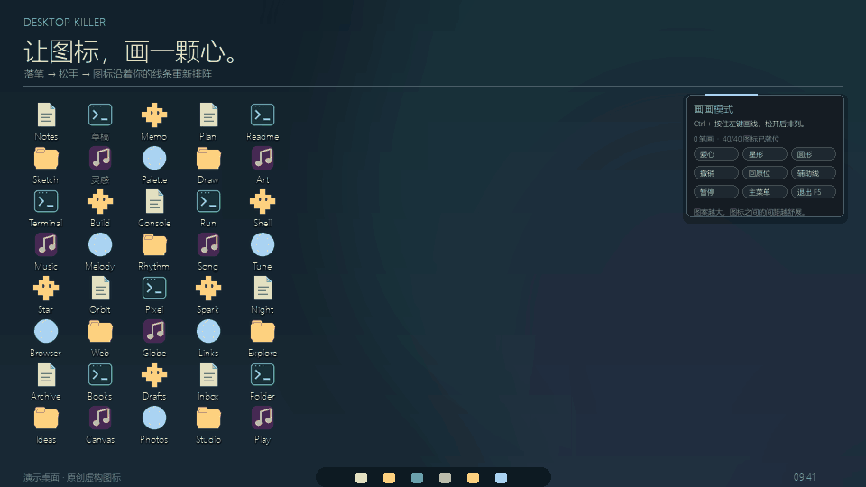

# 桌面叛乱

**今天，轮到桌面清理你。**

[**下载试玩 · Windows**](https://github.com/3021244161/desktop-killer/releases/download/v0.4.0/DesktopKiller-v0.4.0-win-x64.zip)

Chrome 在瞄准你，Steam 已经冲过来了。

连「新建文件夹」都离开了原位，想给你两下。

带上小幽灵，在你每天盯着的那张壁纸上，杀出一条路。

## 别急着庆祝，它正在重启。

图标倒下，**它原来的位置亮起了重启倒计时。**

继续躲弹幕，还是顶着追兵冲回去断链？慢一步，那个老熟人就会重新站起来，变得更快、更难打。

把子弹打成扇面，让电弧在图标之间乱窜，再给自己围一圈刀刃。然后小心那个突然变大的图标——主控找上它了。

主控一醒，鼓点也跟着提速。挨了一下，战场轻轻一震；屏幕边缘开始泛红时，该找机会喘口气了。

## 先停火，排个爱心。

按住 **Ctrl + 鼠标左键**，随手画几笔。

松开。刚才还在围攻你的图标，会慢慢走过去，沿着笔迹站好。

画颗心，画颗歪歪扭扭的星星，或者签个名。

**你画轮廓，整桌图标负责站队。**

动图使用演示桌面和原创图标。进入游戏后，站起来的是你自己的桌面图标。

## 再来一局，还是再画一笔？

- **重启行动**：打穿三章，揪出接管桌面的主控。
- **极速清理**：只有三分钟，看谁先把谁清理掉。
- **无限循环**：继续叠火力，继续迎接复活的老熟人，直到你喊停。
- **画画模式**：今天不打了。让浏览器、回收站和文档一起摆个造型。

打完还能换上猫耳、骑士盔或巫师帽，再回桌面会会它们。

---

**[让我的桌面活过来 →](https://github.com/3021244161/desktop-killer/releases/latest)**

下载、完整解压，双击 `DesktopKiller.exe`。想收场时按 **F5**。

*图标会叛乱，文件不会受伤。退出游戏，桌面恢复原样。*

[怎么玩](docs/玩法指南.pdf) · [更新记录](RELEASE_NOTES.md) · [开发与兼容](docs/DEVELOPMENT.md)

Windows x64 · 当前实测 Win10，Win11 待实机验证。
